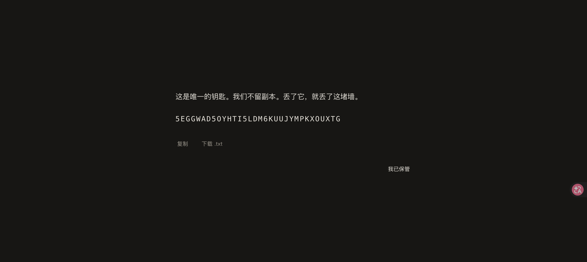

# BiMail — 一堵只有两个人的墙

[](https://github.com/qaz20011230/BiMail/actions/workflows/ci.yml) · [线上访问](https://bimail.liang.world) · [GitHub 仓库](https://github.com/qaz20011230/BiMail)

> **双人封闭、异步、只追加、无过程信号的纯文本留言板。**
>
> 线上地址：**https://bimail.liang.world** · 仓库：**https://github.com/qaz20011230/BiMail**
>
> 产品定义（唯一权威）：[`docs/SPEC.md`](docs/SPEC.md) · 工程契约：[`docs/CONTRACT.md`](docs/CONTRACT.md) · 独立验收：[`docs/ACCEPTANCE.md`](docs/ACCEPTANCE.md) · 后端说明：[`docs/BACKEND.md`](docs/BACKEND.md)

---

## 这是什么

一个只存在两个人的墙：两个座位、一条按天分组的不可变文本序列、一个界面。

- **没有**已读、在线、正在输入、送达、倒计时、红点、推送、头像、昵称、图片、链接预览、AI 代笔。
- **只有**结果：你真正写下的字，和“哪一天”。
- `Enter` 换行，`⌘/Ctrl + Enter` 寄出；空输入时界面上不存在任何控件。
- 写下即不可撤回；未寄出的文字仍属于你，可以撤回。
- 两把钥匙各归各人，服务端只存哈希；**不承诺端到端加密**，明文在库里（见「安全与信任边界」）。

---

## 线上状态（2026-11-12）

| 项 | 值 |
|---|---|
| 访问地址 | **https://bimail.liang.world**（HTTPS 有效；`http://` → 301 https；GitHub Pages Enforce HTTPS 已开启） |
| 前端托管 | GitHub Pages，发布源 = `gh-pages` 分支 /(root)，`CNAME` = `bimail.liang.world` |
| 生产后端 | Supabase 项目 `gcxbxllmusdpnskpdlcj`（Singapore / ap-southeast-1），匿名登录已开启，迁移已执行 |
| DNS | DNSPod：`bimail` CNAME → `qaz20011230.github.io` |
| CI | push `main` 自动跑 `npm run check`（类型/文案/色彩/单测/集成/SQL/构建/预算），当前全绿 |
| 生产验收 | API 层 20 项断言通过（匿名登录、双向寄出、RLS 第三方零行、幂等、换座、关墙、限流）；浏览器层全流程通过（凭据屏 → 建墙 → 密钥屏 → 寄出 → 设置 → 销毁）；**closed 墙 →「再建一堵新墙」→ 新密钥屏 → 新墙**已于生产浏览器验证 |
| 数据 | 生产库已清空（无测试墙），可直接从干净状态开始 |

发布/更新前端（anon key 是公开 key，可进入前端包；**不要**提交 `.env.local`）：

```bash
set -a && . ./.env.local && set +a          # 本地生产配置（gitignored）
VITE_BACKEND=supabase npm run build
rm -rf /tmp/bimail-ghpages && mkdir -p /tmp/bimail-ghpages
cp -R dist/. /tmp/bimail-ghpages/
printf 'bimail.liang.world\n' > /tmp/bimail-ghpages/CNAME
touch /tmp/bimail-ghpages/.nojekyll
cd /tmp/bimail-ghpages && git init -q -b gh-pages && git add -A \
  && git -c user.email=deploy@bimail.local -c user.name=bimail-deploy commit -qm "deploy" \
  && git push git@github.com:qaz20011230/BiMail.git gh-pages --force
```

---

## 界面（真实浏览器截图，详见 [`docs/evidence/`](docs/evidence/)）

| 桌面亮色（两人墙） | 移动端输入中 | 设置面 |
|---|---|---|
|  |  |  |

| 恢复密钥屏 | 凭据屏（含建墙入口） | 暗色 |
|---|---|---|
|  |  |  |

**线上实拍**（`https://bimail.liang.world`，Supabase 生产后端）：


---

## 快速开始（本地，零后端服务）

```bash
npm install
npm run dev        # API: 127.0.0.1:8787 + Web: http://localhost:5173
```

1. 首个访问者看到**凭据屏**：输入旧钥匙回来，或点「建一堵新墙」→ 建墙（`nascent`，座位 a）→ 展示恢复密钥 →「我已保管」。
2. 空墙提示 + 邀请链接（纯文本行，选中/长按复制）→ 把这行链接交给对方。
3. 对方打开链接 → 自动匿名占座（座位 b）→ 自己的恢复密钥屏 → 看到封缄的信。
4. 双方写信；刷新、断网、关闭页面都不会丢字；离线寄出会回落本地队列，联网后按序补寄。
5. 流底部「设置」：查看恢复密钥 / 导出全部文字 / 让其他设备离开 / 离开并销毁我的文字。

`npm run dev` 使用**零依赖开发后端**（Node 内置 `node:sqlite`；数据在 `server/data/bimail.db`，已 gitignore），
它实现了与生产 Supabase 完全相同的 HTTP 契约，用于本机演示与端到端验收。

---

## 工程结构与关键决策

```
src/
  main.ts / App.vue          单界面屏幕状态机（A5：唯一表面）
  components/
    WallScreen.vue           流滚动、阅读位置、来访同步、下拉手势、寄出后 160ms 滚动
    Composer.vue             输入框：空态零控件、IME 守卫、归一化、草稿、吸底
    EntryStream / DayGroup / EntryRow / StreamLine   流与日游程渲染
    RecoveryScreen / LostKeyScreen / SettingsView    规格明确允许的三个文字屏
  lib/
    store.ts                 集成中枢：屏幕状态机 + 同步 + 寄出队列 + 恢复密钥流
    adapter.ts / local-adapter.ts / supabase.ts      后端抽象与两个实现
    grouping.ts              日游程分组（不排序、不去重、不重排）
    read-position.ts         last_seen_seq（仅本设备，绝不上行）
    input.ts / draft.ts / queue.ts                   归一化、草稿、离线队列
    recovery-key.ts / export.ts                      160 位 Base32 钥匙、纯文本导出
    date.ts / invite-url.ts / storage.ts / errors.ts
  copy.ts                    全部界面文案的唯一来源（§7 逐字实现）
  styles/tokens.css/base.css 设计令牌与版式（对比度/色相/留白规格）
server/
  dev-server.mjs             零依赖开发后端（HTTP 契约见 docs/CONTRACT.md §3）
  store.mjs                  node:sqlite 数据层（外键/唯一约束/幂等/限流）
supabase/
  migrations/0001_init.sql   表、视图、RLS、security definer RPC（生产库已执行）
  migrations/0002_rpc.sql
tests/
  unit/**                    Vitest：214 条
  integration/**             node:test：25 条（真实 HTTP 全链路）
  sql/                       PGlite 跑迁移 + 权限/RLS 断言（16 组）
  e2e/README.md              浏览器复跑手册
scripts/
  check-copy.mjs             禁用词与结构禁令扫描
  check-contrast.mjs         对比度/色相可验收断言
  check-budget.mjs           gzip 体积、请求数、CSP、零三方
```

### 为什么有两套后端

- **生产**：Supabase Auth 匿名登录 + Postgres + RLS + `security definer` RPC；不启用 Realtime/Storage/Edge Functions；不引入 `supabase-js`，`src/lib/supabase.ts` 手写 fetch 客户端（约 200 行）。
- **本机**：同一契约的零依赖开发后端，使“两人一墙”的全流程可以**在没有云账号的情况下端到端验收**。
- 两种实现由 `VITE_BACKEND` 切换：`local`（默认）/ `supabase`。**没有静默降级**：Supabase 配置缺失会显式失败。

---

## 验收（可复跑）

```bash
npm run check          # typecheck + 文案 + 色彩 + 单测 + 集成 + SQL + 构建 + 性能预算
```

| 命令 | 内容 |
|---|---|
| `npm run typecheck` | `vue-tsc --noEmit`，0 错误 |
| `npm test` | 214 条单元测试（输入/草稿/队列/流渲染/密钥/导出/store 状态机等） |
| `npm run test:integration` | 25 条真实 HTTP 全链路测试（双人流程、幂等、T1/T4/T5/T6/T7、限流、关墙） |
| `npm run test:sql` | PGlite 执行 Supabase 迁移，断言 RLS/权限/视图字段集/外键/幂等（16 组） |
| `npm run check:copy` | 禁用词（30 项）与结构禁令（12 类：弹窗/轮询/WebSocket/`v-html`/`<a>`/第三方 URL…） |
| `npm run check:contrast` | 正文对比度 ≥12:1、淡语 ≥4.5:1、单暖色相、色度 ≤6% |
| `npm run build && npm run check:budget` | 首屏 JS/CSS gzip、请求数、CSP、零图片/零 Web Font/零第三方 |

**实测**：

- 体积：本地模式 JS **37.70KB gzip** / Supabase 生产包 **39.74KB gzip**（预算 55KB）、CSS **2.07KB**（预算 6KB）、首屏 **2 请求**、零图片、零 Web Font、零第三方脚本、CSP 内联于 `dist/index.html`。
- 4G + CPU 4x + 390×844 仿真：**LCP 324ms（冷启）/ 348ms（回访）**、**INP ≈64ms**（阈值 1.0s / 100ms）。
- 1013 条历史：首屏 120 → 上翻 240，DOM 恒 ≤240，滚动 avg 15.8ms/帧。
- 屏内可见留言中位数：桌面 2 / 移动 1（≤4）；空闲 10s 网络请求 0、WebSocket 0。

浏览器级验收与逐条 DoD 证据见 [`docs/ACCEPTANCE.md`](docs/ACCEPTANCE.md)（独立 QA，24/24 通过），复跑手册见 [`tests/e2e/README.md`](tests/e2e/README.md)。

---

## 忘记恢复密钥怎么办（FAQ）

BiMail **没有“密码”**，只有建墙时展示一次的**恢复密钥**（160 位熵 → 32 字符 Base32；服务端只存 SHA-256）。同一设备会在本地保存一份副本，所以绝大多数“忘记”都能自救：

| 情况 | 处理 |
|---|---|
| **同一浏览器仍能打开那堵墙** | 直接继续用；进 **设置 → 查看恢复密钥**（二次确认后展示）→ 复制 / 下载 `.txt` 保存。忘记钥匙不影响当前设备继续写。 |
| **换了设备 / 清了缓存，但钥匙还留着** | 在凭据屏输入钥匙 →「进入」即可回到原墙（座位标识与加入日期不变）。 |
| **钥匙和本地会话都丢了** | 那堵墙**不可恢复**——服务端只有哈希，没有客服，没有第三个人能开门。这是产品有意设计的边界。若对方已占座，对方仍可读写那堵墙。 |
| **想彻底重新开始** | 清除该站点的网站数据（或用无痕窗口 / 另一浏览器）→ 刷新 → 凭据屏点「建一堵新墙」。同一匿名身份只能有一堵墙（A1），新身份即可新墙；旧座位可由服务器管理员后台清理。 |
| **清缓存后凭据屏没有「建一堵新墙」** | 该死路已于 2026-11-12 修复并上线：只要当前身份没有座位，凭据屏一定同时给出「建一堵新墙」。若仍看不到，刷新页面或清除站点数据以排除旧版本缓存。 |
| **邀请链接丢了 / 过期** | 邀请链接 7 天有效、只能消费一次，且**不支持重新生成**。若对方尚未占座且链接已过期：用新身份建一堵新墙、把新链接交给对方；旧墙无法恢复邀请。 |
| **想放弃已有墙** | 设置 →「离开并销毁我的文字」：硬删除自己的全部留言，墙置 `closed`，不可写、不可邀、不可重开；对方仍可读自己的留言。若想开始新的一堵，见下一行。 |
| **旧墙已经停下（closed），想开新墙** | `closed` 墙的流底部有「再建一堵新墙」：确认后离开旧墙（你的文字会从这堵墙删除，建议先导出），旧墙不再可读；随后进入新墙的恢复密钥屏。这是 A1 按「活跃墙」的解释：一个身份最多一堵活跃墙，旧墙显式离开后不再占用身份。见 [截图](docs/evidence/12-closed-new-wall.png)。 |

> 预防：建墙时立刻点「复制」或「下载 .txt」，存进你的密码管理器/离线笔记。

---

## 部署与维护

### 线上架构（当前）

```
Browser ──HTTPS──> GitHub Pages (gh-pages 静态产物, custom domain, CSP)
   │
   └──fetch──> Supabase (Auth 匿名登录 + PostgREST + Postgres/RLS/RPC, ap-southeast-1)
```

- GitHub Pages 设置：Settings → Pages → Deploy from a branch → `gh-pages` /(root)；Custom domain `bimail.liang.world`；Enforce HTTPS 已开。
- DNS：`bimail` CNAME → `qaz20011230.github.io`（DNSPod）。
- Supabase 项目通过 GitHub 账号登录管理；数据库密码只保存在本地 `BiMail/.env.local`（gitignored）。

### 更新线上前端

见上文「线上状态」中的命令：`npm run build`（`VITE_BACKEND=supabase`）→ 把 `dist/` 推到 `gh-pages` 分支。push 到 `main` 只跑 CI，不自动部署。

### 数据库运维（管理员）

- 项目 ref：`gcxbxllmusdpnskpdlcj`；迁移文件：`supabase/migrations/*.sql`（生产已执行；幂等友好）。
- 本地连接（IPv4）：Session pooler `aws-1-ap-southeast-1.pooler.supabase.com:5432`，用户 `postgres.gcxbxllmusdpnskpdlcj`，密码见 `.env.local`。
- 清空全部墙（**仅测试/重置环境；不可恢复**）：

```sql
delete from public.entry;
delete from public.invite;
delete from public.seat;
delete from public.dyad;
delete from public.rebind_attempt;
```

- 部署后冒烟：`curl -sS -o /dev/null -w '%{http_code}\n' https://bimail.liang.world/`（200）；匿名登录/建墙/寄出可用生产页面手工走一遍。
- Free 计划：项目连续约 7 天无请求可能被暂停，访问一次即可唤醒；额度与限制见 Supabase 控制台。

### 从零部署

1. Supabase → 新建项目 → **Auth → Providers → Allow anonymous sign-ins** 打开。
2. SQL Editor 依序执行 `supabase/migrations/0001_init.sql`、`0002_rpc.sql`（或 Supabase CLI）。
3. 记录 Project URL 与 legacy `anon` key（Settings → API Keys）；**永远不要把 `service_role` key 放进前端。**
4. 构建：`VITE_BACKEND=supabase VITE_SUPABASE_URL=… VITE_SUPABASE_ANON_KEY=… npm run build`，把 `dist/` 静态托管（GitHub Pages / 任意静态空间；`base: './'` 支持子路径）。
5. 自定义域 + HTTPS 由静态托管方负责；CSP 由构建注入，`connect-src` 已放行 `https://*.supabase.co`；若托管方支持响应头，额外补 `frame-ancestors 'none'` 与 `Strict-Transport-Security`。

更细的 Supabase 建项、迁移与威胁模型见 [`docs/BACKEND.md`](docs/BACKEND.md)。

---

## 安全与信任边界（不承诺什么）

- 不承诺端到端加密；运营方可在库中读到明文。产品文案不出现“绝对安全/军事级加密”。
- 未消费的邀请链接被第三方获得 → **可被冒充占座**（残余风险已明示）；token 192 位熵、7 天时效、单次消费、置于 URL fragment 且读取后立即 `replaceState` 清除。
- 已消费链接无能力；非成员查询返回零行（RLS）；分秒时间戳永不出库（视图字段集断言）。
- 恢复密钥 160 位熵、服务端只存 SHA-256；丢失钥匙且丢失设备 ⇒ 座位不可恢复（没有客服）。
- 供应链：严格 CSP、单前端依赖（vue）、锁文件、零第三方脚本；静态托管方仍属信任根。

---

## 规格内部冲突的裁定（诚实记录）

1. **暗色笔友墨色**：SPEC §4.1 给定暗色 `#C9C4BA`，对纸 `#171614` 实测仅 10.41:1，达不到同节“正文 ≥12:1”。裁定：保留色相/色度，调整为 `#D8D3C9`（12.13:1），以可验收阈值为准。
2. **`seat.joined_on` 使用 UTC 日期**（SPEC §5.2 明确 `(now() at time zone 'utc')::date`）。UTC+8 深夜建座时，派生语“两位笔友到齐”可能比写作者本地日期早一天；规格给定 UTC，不重排、不换算。
3. **邀请明文只出现在建墙响应**：服务端只存 token 哈希，`wall_state` 不回传明文；创建者设备在 localStorage 保存明文以便刷新后回显。**清空设备存储后邀请链接不可再取回**（无服务端重发）。
4. **Composer 无焦点光环**（SPEC §3.2），键盘可达性由插入光标与其余控件的 `:focus-visible` 1px 描边承担。
5. **移动端不存在“75% 留白”**（SPEC §4.2 自述）：桌面 ≥1280px 时两侧合计留白 ≥53%，移动端左右边距 20px。
6. 恢复密钥屏在生成时即存本设备（否则设置面“查看恢复密钥”无法实现——服务端只有哈希）；设置面二次确认后才展示。
7. **首次抵达与清空缓存不可区分**：两者都是“无会话、无钥匙、无邀请”的全新匿名身份。实现给出凭据屏 +「建一堵新墙」，让人自己选；**只要当前身份没有座位，凭据屏就一定同时给出建墙入口**（2026-11-12 修复旧钥匙残留导致的死路）。
8. **Supabase `rebind_seat` 以 200 + `error` 返回业务错误**（PostgreSQL `raise` 会回滚限流计数，导致“失败也计次”失效）；客户端对 4xx 与 200+error 做同一映射。`security_invoker` 视图需要底层列级 SELECT，故 `authenticated` 仅有视图所需列的读权限（`created_at`/`client_uuid` 仍不可读，表级权限断言为 false）。

9. **closed 墙的离开与新墙**（2026-11-12 增加）：`closed` 墙在流尾提供「再建一堵新墙」。确认后 `leave_closed_wall` 删除自己的留言并释放座位（`seat.released_at`，保留 slot/joined_on 历史行），随后可建立新墙。A1 解释为「最多一堵**活跃**墙」；不新增会话列表或界面，旧墙经显式离开后不可读。

其余 MVP 决策（派生语位置、导出标签、凭据屏、closed 行为等）见 [`docs/CONTRACT.md §8`](docs/CONTRACT.md)。

---

## 已知边界与残余风险

- **真实中文/日文 IME、真机移动键盘与 safe-area、Safari/Firefox** 未实机覆盖；浏览器验收为 Chromium（Tabbit）+ CDP 仿真。
- **DoD 6 的“30 分钟断网”**以“草稿仅本地、节流 300ms、blur/hidden 立即写、重载/断网不丢、永不上传”的机制验证替代，未字面等待 30 分钟。
- 端到端浏览器验收未覆盖“生产环境双设备两人全程”（API 层已覆盖完整双人流程）；首次真实使用建议用两个浏览器走一遍邀请占座。
- 邀请链接不支持重发；创建者清空设备存储后无法取回旧链接。
- Supabase **legacy anon key 将于 2027 年初逐步退役**，届时需切换到 publishable key 并做一次客户端小适配。
- 生产数据库仅存明文 + 行级隔离，**无端到端加密**；运营方可读。匿名注册开放，Free 计划下存在被滥用/刷额度的风险，必要时可加 Supabase Rate Limits/CAPTCHA。
- 历史分页按 SPEC 只加载最近 240 条（120 + 120），更早内容通过「导出全部文字」携带；不做应用内搜索（不重复浏览器能力）。

---

## 文案与约束纪律

- 所有界面文字来自 `src/copy.ts`；`npm run check:copy` 拦截 30 个禁用词（聊天/会话/好友/用户/消息/在线/已读/绝对安全…）与 12 类结构禁令（弹窗、Toast、轮询、WebSocket、`supabase-js`、`v-html`、内容链接、第三方 URL…）。
- 全站色相数 = 1，无强调色；唯一动效是 120ms 淡入与 160ms 滚动，`prefers-reduced-motion` 下归零。
- 无图片、无 Web Font、无第三方脚本；`created_at` / `client_uuid` / 阅读位置永不出库/不上行。

---

## 变更记录

| 日期 | 内容 |
|---|---|
| 2026-11-12 | **上线** `https://bimail.liang.world`：GitHub Pages（gh-pages）+ Supabase（Singapore）+ DNSPod CNAME；HTTPS 与 Enforce HTTPS 生效 |
| 2026-11-12 | 生产冒烟 20 项 + 浏览器全流程通过；清理生产测试数据 |
| 2026-11-12 | **修复**：旧钥匙残留导致凭据屏无建墙入口的死路（身份无座位时始终提供「建一堵新墙」），已发布并生产验证 |
| 2026-11-12 | 仓库上传：独立验收 24/24 DoD、214 单测 / 25 集成 / 16 SQL、CI 全绿 |
| 2026-11-12 | **新功能上线**：`closed` 墙可离开旧墙并开新墙（`leave_closed_wall` + 部分唯一索引，活跃墙仍一人一墙）；迁移 `0003_leave_closed_wall.sql` 已应用生产；API 冒烟、217 单测 / 28 集成 / 17 SQL 与生产浏览器流程全部通过 |
