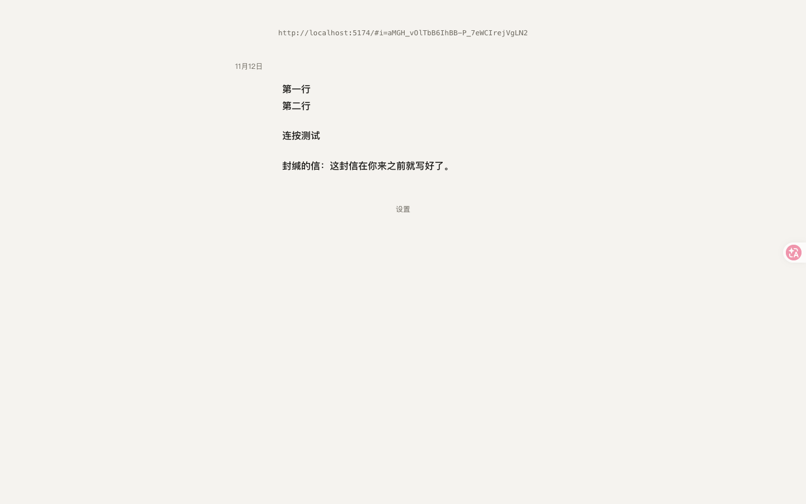
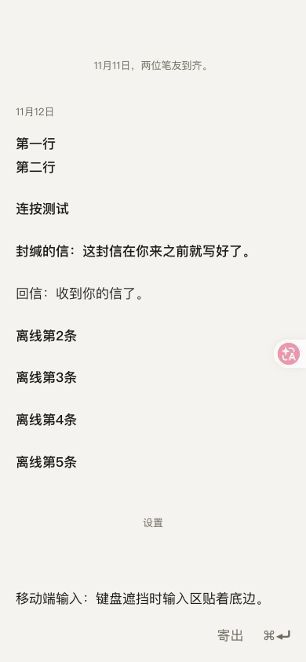
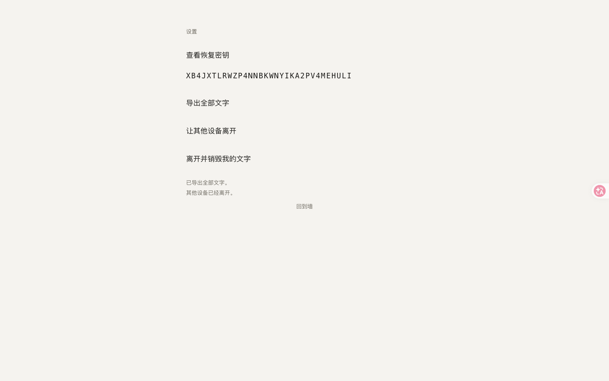
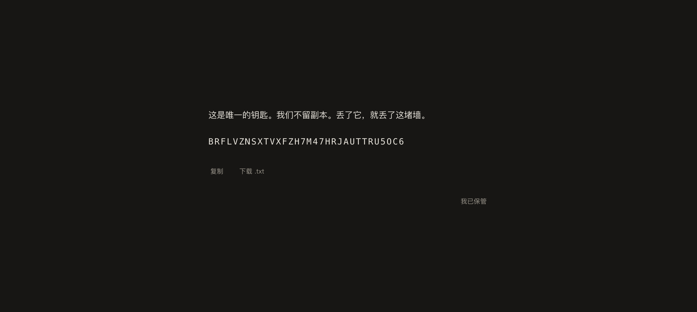
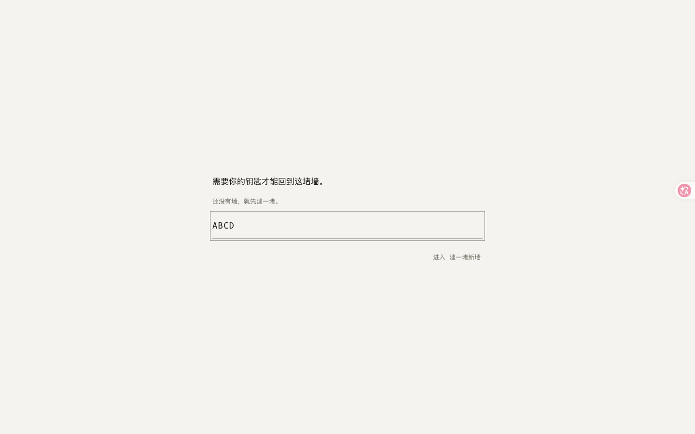
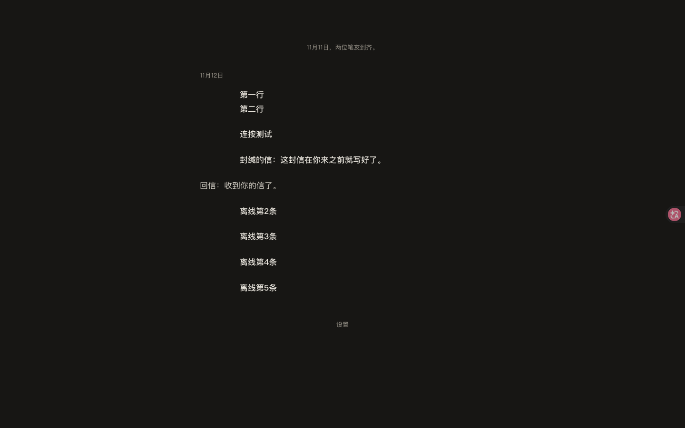
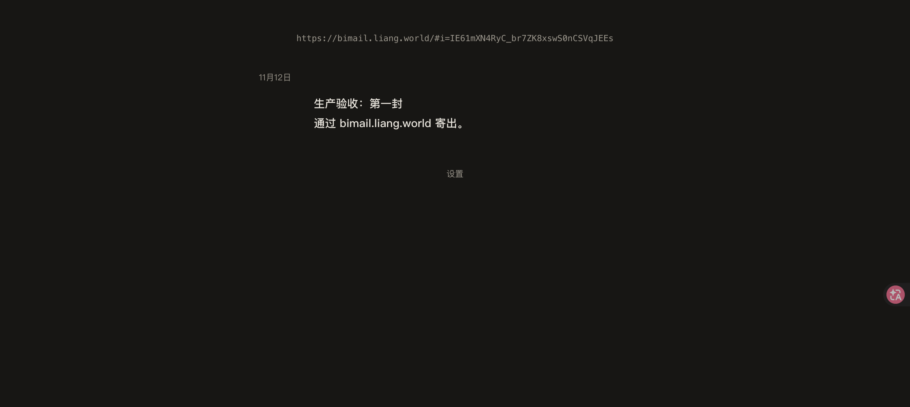

# BiMail — 一堵只有两个人的墙

> **双人封闭、异步、只追加、无过程信号的纯文本留言板。**
>
> 产品定义（唯一权威）：[`docs/SPEC.md`](docs/SPEC.md) · 工程契约：[`docs/CONTRACT.md`](docs/CONTRACT.md) · 验收记录：[`docs/ACCEPTANCE.md`](docs/ACCEPTANCE.md)

---

## 这是什么

一个只存在两个人的墙：两个座位、一条按天分组的不可变文本序列、一个界面。

- **没有**已读、在线、正在输入、送达、倒计时、红点、推送、头像、昵称、图片、链接预览、AI 代笔。
- **只有**结果：你真正写下的字，和"哪一天"。
- `Enter` 换行，`⌘/Ctrl + Enter` 寄出；空输入时界面上不存在任何控件。
- 写下即不可撤回；未寄出的文字仍属于你，可以撤回。
- 两把钥匙各归各人，服务端只存哈希；**不承诺端到端加密**，明文在库里（见 §7）。

---

## 快速开始（零后端服务）

```bash
npm install
npm run dev        # API: 127.0.0.1:8787 + Web: http://localhost:5173
```

打开 `http://localhost:5173`：

1. 首个访问者看到**凭据屏**：输入旧钥匙回来，或点「建一堵新墙」→ 建墙（`nascent`，座位 a）→ 展示恢复密钥 →「我已保管」。
2. 空墙提示 + 邀请链接（纯文本行，选中/长按复制）→ 把这行链接交给对方。
3. 对方打开链接 → 自动匿名占座（座位 b）→ 自己的恢复密钥屏 → 看到封缄的信。
4. 双方写信；刷新、断网、关闭页面都不会丢字；离线寄出会回落本地队列，联网后来访自动按序补寄。
5. 流底部「设置」：查看恢复密钥 / 导出全部文字 / 让其他设备离开 / 离开并销毁我的文字。

`npm run dev` 使用**零依赖开发后端**（Node 内置 `node:sqlite`；数据在 `server/data/bimail.db`，已 gitignore），
它实现了与生产 Supabase 完全相同的 HTTP 契约，用于本机演示与端到端验收。

生产目标为 Supabase（匿名 Auth + Postgres + RLS + 手写 PostgREST 客户端），见 §6。

### 界面（真实浏览器截图，详见 [`docs/evidence/`](docs/evidence/)）

| 桌面亮色（两人墙） | 移动端输入中 | 设置面 |
|---|---|---|
|  |  |  |

| 恢复密钥屏 | 凭据失效屏 | 暗色 |
|---|---|---|
|  |  |  |

**线上实拍**（`https://bimail.liang.world`，Supabase 生产后端）：



---

## 工程结构与关键决策

```
src/
  main.ts / App.vue          单界面屏幕状态机（A5：唯一表面）
  components/
    WallScreen.vue           流滚动、阅读位置、来访同步、下拉手势、寄出后 160ms 滚动
    Composer.vue             输入框：空态零控件、IME 守卫、归一化、草稿、吸底
    EntryStream / DayGroup / EntryRow / StreamLine   流与日游程渲染
    RecoveryScreen / LostKeyScreen / SettingsView    规格明确允许的三个文字屏
  lib/
    store.ts                 集成中枢：屏幕状态机 + 同步 + 寄出队列 + 恢复密钥流
    adapter.ts / local-adapter.ts / supabase.ts      后端抽象与两个实现
    grouping.ts              日游程分组（不排序、不去重、不重排）
    read-position.ts         last_seen_seq（仅本设备，绝不上行）
    input.ts / draft.ts / queue.ts                   归一化、草稿、离线队列
    recovery-key.ts / export.ts                      160 位 Base32 钥匙、纯文本导出
    date.ts / invite-url.ts / storage.ts / errors.ts
  copy.ts                    全部界面文案的唯一来源（§7 逐字实现）
  styles/tokens.css/base.css 设计令牌与版式（对比度/色相/留白规格）
server/
  dev-server.mjs             零依赖开发后端（HTTP 契约见 docs/CONTRACT.md §3）
  store.mjs                  node:sqlite 数据层（外键/唯一约束/幂等/限流）
supabase/
  migrations/0001_init.sql   表、视图、RLS、security definer RPC
  tests/acceptance.sql       SQL 验收（由 PGlite 驱动，不需要真实 Supabase）
tests/
  unit/**                    Vitest：214 条
  integration/**             node:test：25 条（真实 HTTP 全链路）
  sql/                       PGlite 跑迁移 + 权限/RLS 断言
scripts/
  check-copy.mjs             禁用词与结构禁令扫描
  check-contrast.mjs         对比度/色相可验收断言
  check-budget.mjs           gzip 体积、请求数、CSP、零三方
```

### 为什么有两套后端

- **生产目标**：Supabase Auth 匿名登录 + Postgres + RLS + `security definer` RPC；不启用 Realtime/Storage/Edge Functions；不引入 `supabase-js`，`src/lib/supabase.ts` 手写 fetch 客户端（约 200 行）。
- **本机 MVP**：同一契约的零依赖开发后端，使"两人一墙"的全流程可以**在没有云账号的情况下端到端验收**；测试与契约一致。
- 两种实现由 `VITE_BACKEND` 切换：`local`（默认）/ `supabase`。**没有静默降级**：Supabase 配置缺失会显式失败。

---

## 验收（可复跑）

```bash
npm run check          # typecheck + 文案禁令 + 色彩验收 + 单测 + 集成测试 + SQL 测试 + 构建 + 性能预算
```

| 命令 | 内容 |
|---|---|
| `npm run typecheck` | `vue-tsc --noEmit`，0 错误 |
| `npm test` | 214 条单元测试（输入、草稿、队列、流渲染、密钥、导出、store 状态机等） |
| `npm run test:integration` | 25 条真实 HTTP 全链路测试（双人流程、幂等、T1/T4/T5/T6/T7、限流、关墙） |
| `npm run test:sql` | PGlite 执行 Supabase 迁移，断言 RLS/权限/视图字段集/外键/幂等（见 `tests/sql/run.mjs`） |
| `npm run check:copy` | 禁用词（30 项）与结构禁令（弹窗/轮询/WebSocket/`v-html`/`<a>`/第三方 URL…） |
| `npm run check:contrast` | 正文对比度 ≥12:1、淡语 ≥4.5:1、单暖色相、色度 ≤6% |
| `npm run build && npm run check:budget` | 首屏 JS/CSS gzip、请求数、CSP、零图片/零 Web Font/零第三方 |

**当前实测（生产构建）**：JS **37.70KB gzip**（预算 55KB）、CSS **2.08KB gzip**（预算 6KB）、首屏 **2 个请求**、零图片、零 Web Font、零第三方脚本、CSP 内联于 `dist/index.html`。

浏览器级验收见 [`docs/ACCEPTANCE.md`](docs/ACCEPTANCE.md)（独立 QA，24/24 条 DoD 通过）：

- 4G + CPU 4x + 390×844 仿真：**LCP 324ms（冷启）/ 348ms（回访）**、**INP ≈64ms**（阈值 1.0s / 100ms）。
- 1013 条历史：首屏 120 → 上翻 240，DOM 恒 ≤240，滚动 avg 15.8ms/帧。
- 屏内可见留言中位数：桌面 2 / 移动 1（≤4）；空闲 10s 网络请求 0、WebSocket 0。
- 截图为 Tabbit Chromium 实测，复跑手册见 [`tests/e2e/README.md`](tests/e2e/README.md)。

---

## 规格内部冲突的裁定（诚实记录）

产品定义书本身存在几处互相约束的条款；实现按"可验收的量优先"裁定，并在验收文档中留痕：

1. **暗色笔友墨色**：SPEC §4.1 给定暗色 `#C9C4BA`，但其对比度仅 10.41:1，达不到同节"正文 ≥12:1"的验收阈值。裁定：保留色相/色度不变，调整为 `#D8D3C9`（12.13:1），并以可验收阈值为准。
2. **`seat.joined_on` 使用 UTC 日期**（SPEC §5.2 明确 `(now() at time zone 'utc')::date`）。UTC+8 深夜建座时，"两位笔友到齐"的派生语可能比写作者本地日期早一天。这是规格给定的 UTC 语义，未做本地化改写。
3. **邀请链接的明文只可能出现在建墙响应**：服务端只存 token 哈希，`wall_state` 不回传明文。创建者设备在本机 localStorage 保管明文（`bimail.invite`）以便刷新后回显；**清空设备存储后无法再次取回邀请链接**（无服务端重发机制）。属已知残余风险。
4. **Composer 无焦点光环**（SPEC §3.2），键盘可达性由插入光标与其余控件（词形寄出、设置、钥匙输入等）的 `:focus-visible` 1px 描边承担。
5. **移动端不存在"75% 留白"**（SPEC §4.2 自述）：桌面 ≥1280px 时两侧合计留白 ≥53%，移动端左右边距 20px。
6. 恢复密钥屏在生成时即存本设备（否则设置面"查看恢复密钥"无法实现——服务端只有哈希）；设置面二次确认后才展示。
7. **首次抵达与清空缓存不可区分**：两者都是"无会话、无钥匙、无邀请"的全新匿名身份。实现给出凭据屏 + 「建一堵新墙」入口，让人自己选；清空缓存后仍可用钥匙换回原座位（DoD 19 的 UI 路径由此可达）。
8. **Supabase 的 `rebind_seat` 以 200 + `error` 返回业务错误**（PostgreSQL raise 会回滚限流计数，导致"失败也计次"失效）；客户端对 4xx 与 200+error 做同一映射。`security_invoker` 视图需要底层列级 SELECT，故 `authenticated` 仅有视图所需列的读权限（`created_at`/`client_uuid` 仍不可读，表级权限断言为 false）。

其余 MVP 决策（派生语位置、导出标签、凭据失效屏、closed 行为等）见 [`docs/CONTRACT.md §8`](docs/CONTRACT.md)。

---

## 线上部署（本次已上线）

| 项 | 值 |
|---|---|
| 访问地址 | **https://bimail.liang.world/**（HTTPS 证书已签发，已开启 Enforce HTTPS；`http://` 由 GitHub 边缘节点 301 到 https） |
| 前端托管 | GitHub Pages，发布源 = **`gh-pages` 分支 /(root)**（`CNAME` = `bimail.liang.world`） |
| 生产后端 | Supabase 项目 `gcxbxllmusdpnskpdlcj`（Singapore / ap-southeast-1），匿名登录已开启，迁移已执行 |
| DNS | DNSPod：`bimail` CNAME → `qaz20011230.github.io` |
| 生产冒烟 | API 层：匿名登录、建墙、双向寄出、RLS 第三方零行、幂等、恢复密钥换座、关墙销毁、限流 20 项通过；浏览器层（https://bimail.liang.world）：首访凭据屏 → 建墙 → 密钥屏 → 寄出 → 设置面 → 销毁 → closed，全程无 JS 错误，请求仅命中自身静态资源与 `*.supabase.co` |

**发布/更新前端**（Supabase 的 anon key 是公开 key，可进入前端包）：

```bash
cd BiMail
set -a && . ./.env.local && set +a          # 本地生产配置（gitignored）
VITE_BACKEND=supabase npm run build
rm -rf /tmp/bimail-ghpages && mkdir -p /tmp/bimail-ghpages
cp -R dist/. /tmp/bimail-ghpages/
printf 'bimail.liang.world\n' > /tmp/bimail-ghpages/CNAME
touch /tmp/bimail-ghpages/.nojekyll
cd /tmp/bimail-ghpages && git init -q -b gh-pages && git add -A \
  && git -c user.email=deploy@bimail.local -c user.name=bimail-deploy commit -qm "deploy" \
  && git push git@github.com:qaz20011230/BiMail.git gh-pages --force
```

> `scripts/deploy-pages.mjs` 可将上述步骤自动化（可选）；**不要**把 `.env.local`（含数据库密码）提交到仓库。

---

## 部署（生产，从零开始）

### 1. Supabase

1. 新建项目，并在 **Auth → Providers** 打开 **Anonymous sign-ins**。
2. 在 SQL Editor 依次执行 `supabase/migrations/` 下的迁移（或使用 Supabase CLI `supabase db push`）。
3. 记录 Project URL 与 `anon` key（`Settings → API`）。**永远不要把 `service_role` key 放进前端。**

### 2. 构建与托管（任选）

```bash
VITE_BACKEND=supabase \
VITE_SUPABASE_URL=https://<project-ref>.supabase.co \
VITE_SUPABASE_ANON_KEY=<anon-key> \
npm run build
```

产物是纯静态文件（`dist/`），可托管于 GitHub Pages / 任意静态空间；`base: './'` 支持子路径。

两种发布方式：
- **`gh-pages` 分支（当前线上使用，无需任何 GitHub Secrets）**：本地构建后把 `dist/` 推到 `gh-pages` 分支，Pages 发布源设为该分支；见上文「发布/更新前端」。
- **GitHub Actions（可选）**：`.github/workflows/deploy.yml` 为手动触发；需在仓库 Secrets 配置 `VITE_SUPABASE_URL`、`VITE_SUPABASE_ANON_KEY`，并在 Settings → Pages 选择 GitHub Actions。注意 anon key 本身是公开 key，不是服务端密钥。

### 3. 安全头

生产 CSP 由构建注入 `index.html`（`default-src 'self'; script-src 'self'; … connect-src 'self' https://*.supabase.co`）。若使用自定义 Supabase 域名，请同步调整 `vite.config.ts` 中的 `connect-src`。静态主机支持自定义响应头时，额外补齐 `frame-ancestors 'none'`（meta 形式无法表达该指令）与 `Strict-Transport-Security`。

更细的 Supabase 建项、迁移与威胁模型见 [`docs/BACKEND.md`](docs/BACKEND.md)。

---

## 安全与信任边界（不承诺什么）

- 不承诺端到端加密；运营方可在库中读到明文。产品文案不出现"绝对安全/军事级加密"。
- 未消费的邀请链接被第三方获得 → **可被冒充占座**（残余风险已明示）；token 192 位熵、7 天时效、单次消费、置于 URL fragment 且读取后立即 `replaceState` 清除。
- 已消费链接无能力；非成员查询返回零行（RLS）；分秒时间戳永不出库（视图字段集断言）。
- 恢复密钥 160 位熵、服务端只存 SHA-256；丢失钥匙且丢失设备 ⇒ 座位不可恢复（没有客服）。
- 供应链：严格 CSP、单前端依赖（vue）、锁文件、零第三方脚本；静态托管方仍属信任根。

---

## 已知 MVP 边界

- 生产 Supabase 适配器与迁移已实现，并已用 PGlite + mock Auth 做 SQL 级验收；**尚未对真实 Supabase 项目做线上联调**（需要项目凭据）。首次生产部署请按 `docs/BACKEND.md` 完成 §3 的 T1–T7 冒烟。
- 邀请链接不支持重新生成/重发；创建者清空设备存储后无法再取回邀请链接（另一条路：让尚未占座的一方尽早占座）。
- 清空设备存储后，首次打开的凭据屏同时提供「进入钥匙」与「建一堵新墙」：客户端无法区分"全新访客"与"丢了本地存储的老用户"，故把选择权交还给人，而不是替人新建一堵墙。
- 历史分页按 SPEC 只加载最近 240 条（120 + 120），更早内容通过「导出全部文字」携带；不做应用内搜索（不重复浏览器能力）。
- 端到端浏览器验收在 macOS 上的 Tabbit Browser 中完成；移动端以 390×844 视口模拟，未覆盖真机刘海/键盘差异。

---

## 文案与约束纪律

- 所有界面文字来自 `src/copy.ts`；`npm run check:copy` 会拦截 30 个禁用词（聊天/会话/好友/用户/消息/在线/已读/绝对安全…）与 12 类结构禁令（弹窗、Toast、轮询、WebSocket、`supabase-js`、`v-html`、内容链接、第三方 URL…）。
- 全站色相数 = 1，无强调色；唯一动效是 120ms 淡入与 160ms 滚动，`prefers-reduced-motion` 下归零。
- 无图片、无 Web Font、无第三方脚本；`created_at` / `client_uuid` / 阅读位置永不出库/不上行。
